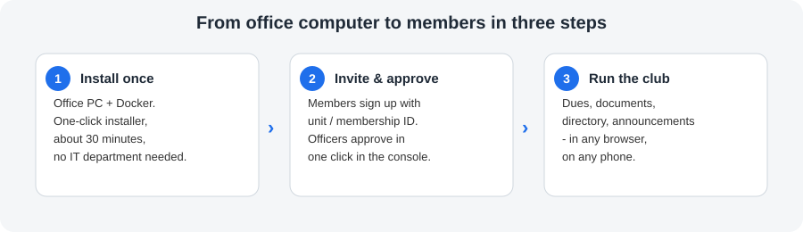
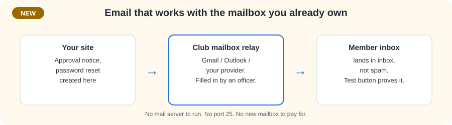
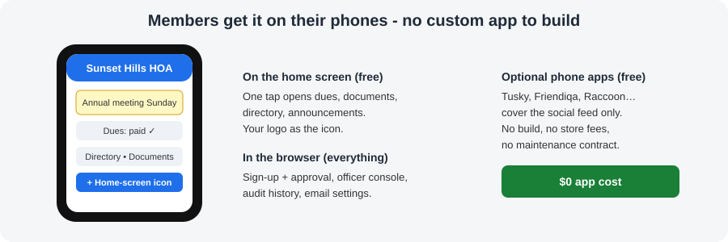

# Social Spot: your organization's own website — dues, documents, directory, done

**One private website per organization** — for HOAs, clubs, non-profits and neighborhoods.
Members see announcements, pay dues, read documents and find each other. Officers run it all
from a plain-language console. No social-network noise, no per-member fees, no custom app to build.

## How it works

1. **Install once** on an office computer (Windows, Mac or Linux + Docker, ~30 minutes with the one-click installer). That computer *is* the server.
2. **Invite & approve** — members sign up with their unit number, address or membership ID; an officer approves in one click. Pre-loaded rosters match people automatically.
3. **Run the club** — announcements, dues ledger, document vault, member directory, committees, positions and a full audit trail, all in the browser, all switchable per organization profile.

## What officers get (everything we built)

| Pitch it as | What it really does |
|---|---|
| **Dashboard, not a timeline** | Members land on announcements, dues standing and documents — the federated feed is hidden by default. |
| **Gated sign-up that holds up** | Address / unit / membership-ID credential, roster matching, officer approval queue, approval audit. |
| **Dues without accounting software** | Simple charges ledger: who owes what, what was paid, open vs settled. |
| **Document vault** | Folders for bylaws, minutes, budgets, forms — per-folder access, board-only records stay board-only. |
| **Announcements that can't be missed** | Pinned banners across every page for as long as they matter. |
| **Committees & positions** | Working groups with chairs; custom positions with granular permissions (who may approve, charge, upload, announce). |
| **Your logo everywhere** | Upload one square image → browser tab, home-screen icon, manifests, Android maskable variants, all resized automatically. |
| **History you can prove** | Every approval, charge, upload and settings change is written to the audit log with who and when. |

## NEW: email that actually reaches members

Password resets and *"your account is approved"* notices now send through **the mailbox the club
already owns** — Gmail, Outlook/365, Yahoo, iCloud or the web host's mail. An officer pastes the
provider's SMTP details into **Console → Organization settings → Email** and proves it with the
**Send test email** button. Step-by-step values and app-password locations:
`docs/email-setup.md`.

- Nothing to know at install time — configure it when the club adopts the site.
- No mail server to run, no port 25, no spam-folder lottery of self-sent mail.
- Password stored once, never shown again; blank keeps it; clearing both fields switches mail off.
- Until it's configured the console says so, so nobody believes resets are working when they aren't.

## On phones: two free routes, $0 app cost

- **Home-screen icon (tell members this first):** any page offers *Add to home screen* —
  iPhone Share steps, Android direct install — opening straight to the dashboard in its own window.
- **Free feed apps (optional):** Tusky, Friendiqa, Raccoon for Friendica and other Mastodon-API
  clients sign in with the site address for the social feed. They never see dues, documents or
  the directory — organization business stays on the site by design. Full story: `docs/mobile-apps.md`.

## Honest answers for hard questions

- **"Is there an app?"** — Yes for the feed (free, existing), but dues/documents/directory live on
  the site itself, which works fine in any phone browser.
- **"What if email isn't set up?"** — Announcements, dues, documents and directory all work.
  Only password resets and approval notices wait — and the console warns you.
- **"Who can change what?"** — Whoever holds the position permission. A site admin can do
  everything; a treasurer can charge and record; a secretary can announce — all auditable.
- **"Do we own the software?"** — AGPL open source; the footer offers the source on every page
  (`docs/licensing-compliance.md`).

## Start a demo conversation

> "Give me one office computer and 30 minutes, and your members get dues, documents, directory
> and announcements on their phones tonight — under your logo, with approvals and money
> tracked. When you're ready, five minutes in Email settings turns on password resets too."

**Leave-behinds:** this page + `docs/office-install-guide.md` (install),
`docs/email-setup.md` (mailbox values), `docs/mobile-apps.md` (phones).
